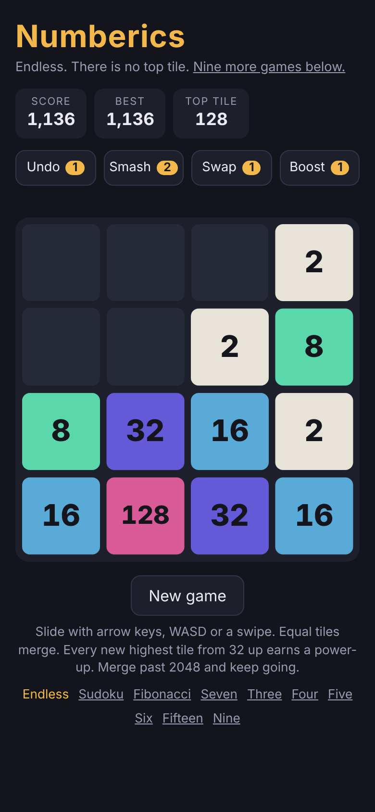
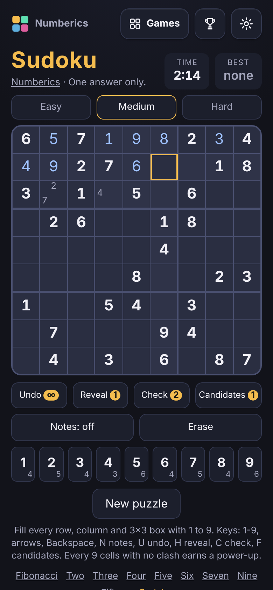
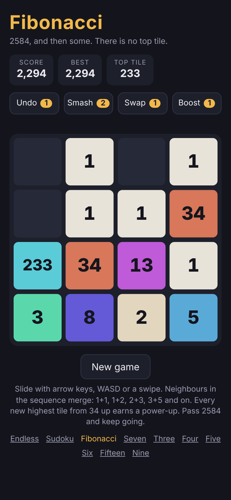
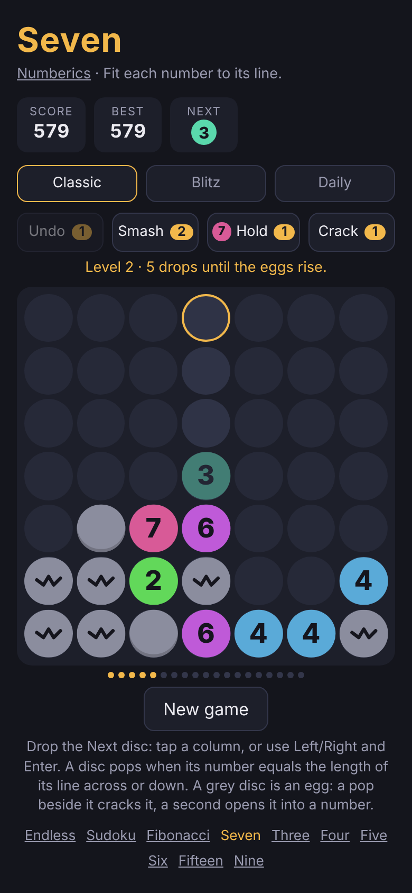
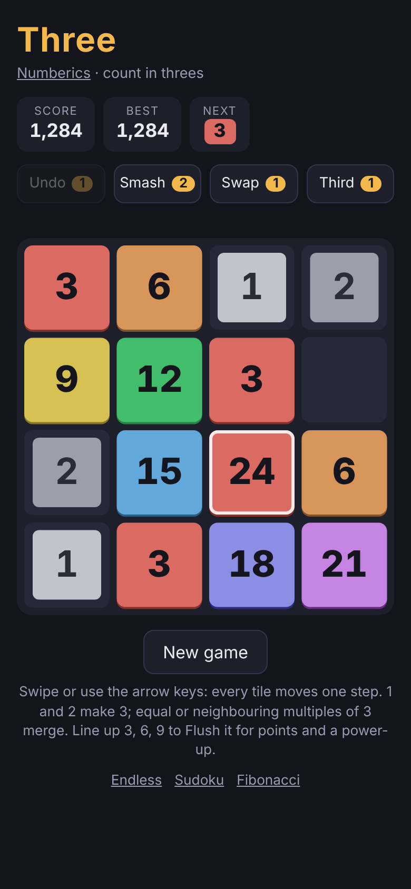
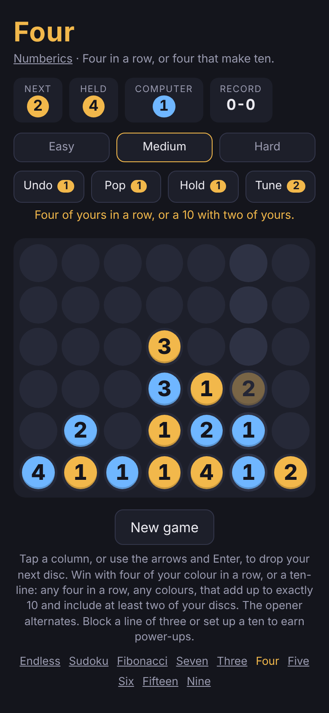
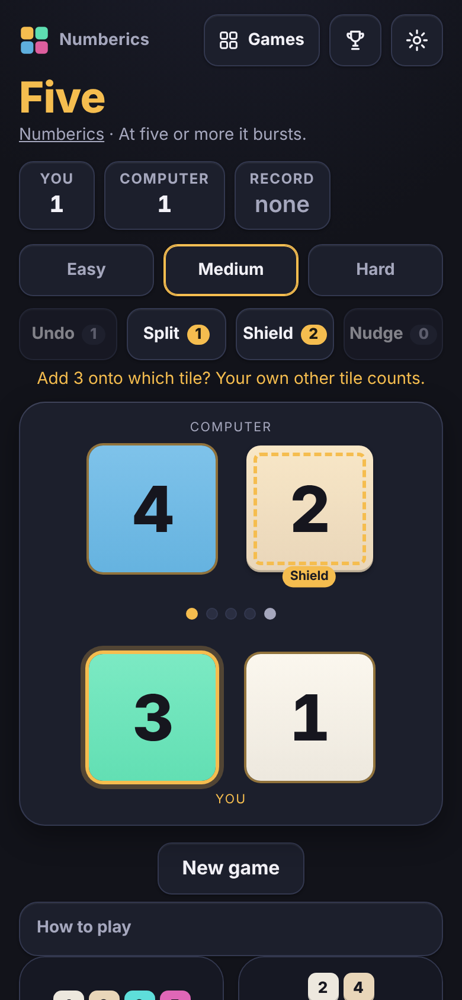
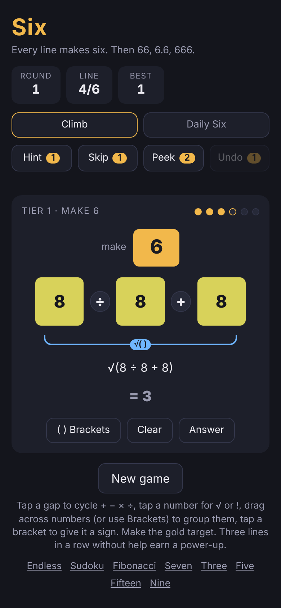
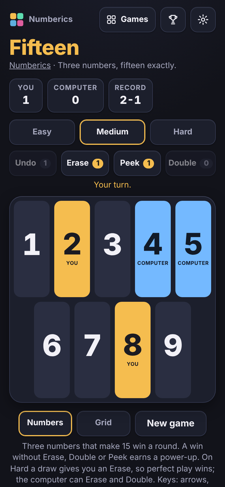
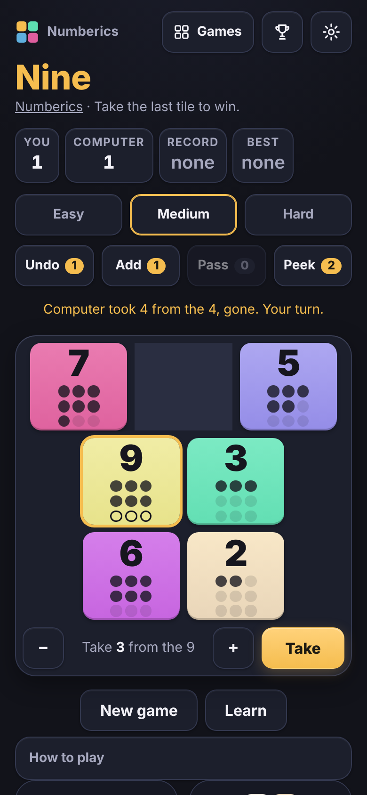

# Numberics

**Play: https://alvations.github.io/numberics/**

Ten number games, no build step, no tracking. Open `index.html` (Endless) and use the games row to switch.

**Numberics Endless** is 2048 with the ceiling removed. Merge past 2048 and keep going: there is no winning
tile, only how far you get before the board locks.

Every new highest tile from 32 up earns a **power-up**: **Undo**, **Smash** (delete a tile), **Swap**
(exchange two cells), **Boost** (double a tile). Use them to dig out of a jam and stay alive.

## The games

- **Endless** (`/`): 2048 with no ceiling, plus earned power-ups.
- **Sudoku** (`/sudoku/`): Classic 9x9, every puzzle has exactly one solution.
- **Fibonacci** (`/fibonacci/`): 2584 with no ceiling: merge neighbours in the Fibonacci sequence.
- **Seven** (`/seven/`): Drop numbered discs; pop seven in one chain for luck.
- **Three** (`/three/`): Count in threes: step merges and rainbow Flush runs.
- **Four** (`/four/`): Four in a row, or any four that sum to ten.
- **Five** (`/five/`): Add one tile onto another; at five it bursts. Beat the computer.
- **Six** (`/six/`): Make every line equal six, then 66, 6.6, 666.
- **Fifteen** (`/fifteen/`): Tic-tac-toe in disguise: first to hold three numbers that sum to 15.
- **Nine** (`/nine/`): Nim with number tiles up to nine: take from one, last take wins.

Every game shares one look, one power-up system (earned by play, never bought) and plays on phone and desktop.

## Screenshots

| **Endless** | **Sudoku** |
|---|---|
|  |  |

| **Fibonacci** | **Seven** |
|---|---|
|  |  |

| **Three** | **Four** |
|---|---|
|  |  |

| **Five** | **Six** |
|---|---|
|  |  |

| **Fifteen** | **Nine** |
|---|---|
|  |  |

Desktop shots are in `screenshots/`. Regenerate with `npm run shots` (needs Playwright).

## Sudoku
Classic 9x9 with three difficulties, pencil notes, undo, hints and red conflict highlighting. Every puzzle is
generated from a seed and has exactly one solution. Keys: `1`-`9`, `Backspace`, `N` notes, `U` undo, `H` hint, arrows.

## Play
Open `index.html`, or `npm start` and visit http://localhost:8070.
Arrow keys / WASD / swipe to slide. `1`-`4` or tap a power-up, then tap a target. `Esc` cancels.

## Develop
No build step and no dependencies.
```bash
npm test                                           # both engines + conventions
NODE_PATH=$(npm root -g) node tests/emulation.cjs  # optional, needs Playwright
```
See `CLAUDE.md` for the rules, `docs/DESIGN.md` for how it works and why.

Apache-2.0. Copyright 2026 alvations (Melon Lab).
